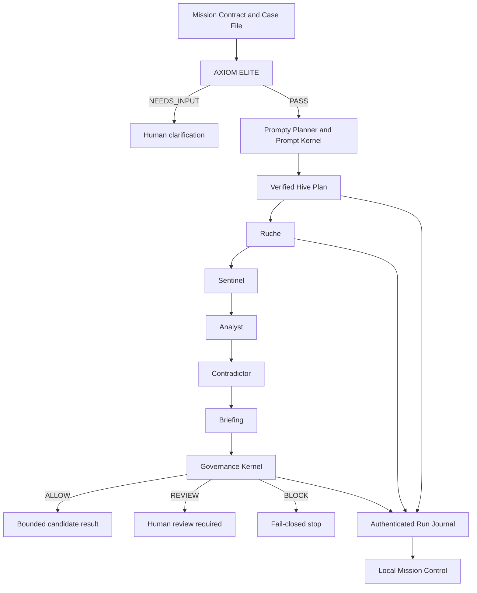

# AXIOM architecture — public map

## Governed execution chain

## Responsibility boundaries

| Component | Responsibility | Explicit limit |
| --- | --- | --- |
| Mission Contract | Declares objective, inputs, constraints and permitted actions | Does not grant general autonomy |
| AXIOM ELITE | Detects omissions, contradictions, assumptions and under-declared risk | Does not approve the mission |
| Prompty Planner | Produces a bounded plan from approved profiles | Cannot freely invent agents or routes |
| Ruche | Executes registered specialist roles through direct governed messages | No uncontrolled intermediary and no external authority |
| Governance Kernel | Applies versioned policy and returns `ALLOW`, `REVIEW` or `BLOCK` | An `ALLOW` remains local to the declared contract |
| Run Journal | Authenticates stages, artifacts and recovery bindings | Is not an identity or non-repudiation service |
| Mission Control | Shows evidence and enforces explicit human gates | Loopback-only, single local operator |

## Fail-closed invariants

AXIOM stops when it encounters an unknown contract, altered evidence, an
unregistered route, a missing approval, a version mismatch, an invalid recovery
binding or an unauthorized action class.

Technical completion and governance approval are separate states. A completed
agent run can still end in `REVIEW` or `BLOCK`.
